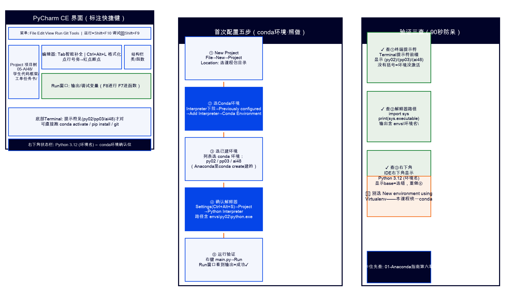

# PyCharm 使用指南（课程版·详细）



> **适用课程**：02-Python编程基础 / 03-Python程序设计（项目实战）/ 05-AI应用基础（48课时版）
> **版本**：PyCharm Community Edition 2025.x（免费开源版，无需注册）
> **配套指南**：`03-Git与GitHub-Gitee使用指南.md`（Git 操作在 PyCharm 中的详细步骤见本文第七章 + 该指南第六章）

## 一、它是什么

专业 Python IDE：智能补全 / 调试 / 内置 Git 版本控制 / 虚拟环境管理。适合中大型工程（《项目实战》首选，《编程基础》全程主编辑器，《AI应用基础》starter 编码）。

**为什么不用 VS Code**：VS Code 需要装扩展才能用 Python，配置较复杂；PyCharm CE 开箱即用，内置 Git/Jupyter/调试，更适合零基础新生。

## 二、安装

### 第1步：下载

1. 打开 https://www.jetbrains.com/pycharm/download/
2. 下载 **Community Edition**（左侧，免费版 — 不要下右侧的 Professional 试用版）
3. **Windows**：下载 `.exe` → 双击运行 → 一路 Next，注意勾选：
   - ✅ **Add launchers dir to the PATH**（加入环境变量）
   - ✅ **.py 关联**（双击 .py 文件用 PyCharm 打开）
4. **macOS**：下载 `.dmg` → 拖入 Applications 文件夹

### 第2步：首次启动

1. 启动 PyCharm → 勾选 "I confirm that I have read..." → Continue
2. 主题选择（Light/Darcula 自选，不影响功能）
3. 跳过插件安装（Default plugins 够用）

## 三、首次配置三步

> 前提：已安装 Anaconda 并用 `conda create -n 环境名 python=3.12` 创建了课程环境（见 `01-Anaconda安装与使用指南.md` 第三章）

### 第1步：新建项目

1. 欢迎界面点击 **New Project**
2. **Location**：选择课程包路径（如 `D:\现代制造\Python编程实战\02-程序设计基础`）
3. **Python Interpreter**：选择 **Previously configured interpreter** → 点 **Add Interpreter** → **Add Local Interpreter**
4. 左侧选 **Conda Environment**
5. **Interpreter** 下拉选已创建的 conda 环境（如 `py02`）
   - 如果下拉没看到 conda 环境：点 **System Interpreter** → 手动指向 `C:\Users\你的用户名\anaconda3\envs\py02\python.exe`（macOS：`/opt/anaconda3/envs/py02/bin/python`）
6. 点击 **OK** → **Create**

> ⚠️ **不要选 "New environment using Virtualenv"**——本课程统一用 conda 环境，不用 venv

> ⚠️ 如果看到 "No Python interpreter" 红色提示：先确认 Anaconda 已装好 → 在终端 `conda env list` 看环境是否创建成功 → 再回到 PyCharm 选

### 第2步：确认解释器

1. 菜单 **File → Settings**（macOS：**PyCharm → Settings**）
2. 左侧 **Project: 项目名 → Python Interpreter**
3. 确认显示的是 conda 环境的 Python（路径含 `anaconda3\envs\py02\python.exe`），不是系统 Python 或 base 环境
4. 如果不对：点齿轮图标 → **Add Interpreter** → **Conda Environment** → 选已有环境

### 第3步：运行第一个文件

1. 在项目树中找到 `main.py`（或任意 .py 文件）
2. 右键 → **Run '文件名'**（或打开文件后点右上角 ▶ 运行按钮）
3. 底部 Run 窗口看到输出 = 成功 ✅

### 第4步：验证 conda 环境

PyCharm 底部 Terminal 输入：
```
python -c "import sys; print(sys.executable)"
```

输出路径含 `envs\py02` = conda 环境生效 ✅

## 四、调试三板斧

### 断点

点击行号右侧的空白处 → 出现**红点**（断点）。程序运行到这里会暂停。

### 调试

点右上角 🐛 **Debug 图标**（或 Shift+F9）启动调试。程序在断点处暂停。

### 看变量

- 底部 **Debugger** 面板显示当前所有变量值
- **Step Over (F8)**：逐行执行（不进函数内部）
- **Step Into (F7)**：进入函数内部
- **Step Out (Shift+F8)**：跳出当前函数
- **Resume (F9)**：继续到下一个断点

> 调试是排查 bug 的核心技能——比 print() 更直观，可以逐行看变量变化

## 五、Jupyter Notebook 在 PyCharm 中

PyCharm CE 支持打开和编辑 `.ipynb` 文件（需安装 Jupyter 插件）：

1. 打开任意 `.ipynb` 文件 → PyCharm 提示安装 Jupyter 插件 → 点 **Install Plugin**
2. 选择解释器为课程 conda 环境（如 `py02`）
3. 每个 Cell 可以单独运行（Ctrl+Enter 运行当前 Cell / Shift+Enter 运行并跳到下一个）

> 05-AI 课全程用 Jupyter 实训；02/03 课部分周次用 Jupyter 做数据探索

## 六、常用快捷键速查表

| 操作 | Windows | macOS |
|---|---|---|
| 运行 | Shift+F10 | ^R |
| 调试 | Shift+F9 | ^D |
| 智能补全 | Ctrl+Space | ^Space |
| 格式化代码 | Ctrl+Alt+L | ⌘⌥L |
| 查找 | Ctrl+F | ⌘F |
| 全局查找 | Ctrl+Shift+F | ⌘⇧F |
| 重命名 | Shift+F6 | ⇧F6 |
| 注释/取消注释 | Ctrl+/ | ⌘/ |
| 复制行 | Ctrl+D | ⌘D |
| 删除行 | Ctrl+Y | ⌘⌫ |

## 七、在 PyCharm 中使用 Git（详细·GitHub/Gitee 双仓支持）

> PyCharm CE 内置 Git 支持，无需安装插件。以下操作以 2025.x 版为准。
> **本课程支持两种代码托管平台**——操作完全平行，只是"账号、仓库地址、令牌"三处不同：
>
> | | GitHub（首选） | Gitee（备选·国内快） |
> |---|---|---|
> | 网址 | github.com | gitee.com |
> | 仓库地址形如 | `https://github.com/用户名/仓库.git` | `https://gitee.com/用户名/仓库.git` |
> | 推送密码 | Personal Access Token | 私人令牌 |
> | 何时用 | 能正常访问时 | GitHub超时/克隆慢(>30秒)时切换 |
>
> 完整 Git 命令与切换流程见 `03-Git与GitHub-Gitee使用指南.md`。

### 7.1 克隆仓库（双仓地址都这么贴）

1. 启动 PyCharm → 欢迎界面点 **Get from VCS**（或 File → New → Project from Version Control）
2. URL 栏粘贴**你的仓库地址**（两平台都在网页仓库页点绿色 **Code/克隆** 按钮复制）：
   - GitHub：`https://github.com/你的用户名/py-homework.git`
   - Gitee：`https://gitee.com/你的用户名/py-homework.git`
3. Directory 选课程包路径 → 点 **Clone** → 完成后自动打开项目

> ⚠️ GitHub 克隆超时？两个办法：①先在终端 `git clone` 再 File→Open 打开目录；②按 03-Git指南第十节两步切换到 Gitee

### 7.2 PyCharm 里登录 GitHub 账号（一次配置，终身免密）

1. 菜单 **File → Settings**（macOS：PyCharm → Settings）→ 左侧 **Version Control → GitHub**
2. 点 **+** → **Log In via GitHub**（会打开浏览器授权）或 **Use Token**（粘贴 Token）
3. 登录后列表显示你的账号 = 后续 push 不再要密码

**Token 怎么来**（浏览器操作）：
GitHub → 右上头像 → **Settings → Developer settings → Personal access tokens → Tokens (classic) → Generate new token** → 勾选 `repo` 权限 → 生成 → **立即复制**（只显示一次）→ 回到 PyCharm 粘贴

### 7.3 PyCharm 里登录 Gitee 账号（同理）

1. **File → Settings → Version Control → Gitee**（没有此项点 **+** 添加 Gitee 插件，PyCharm 2025 已内置）
2. 点 **+** → **Use Token** → 粘贴私人令牌

**私人令牌怎么来**（浏览器操作）：
Gitee → 右上头像 → **设置 → 私人令牌 → 生成新令牌** → 勾选 `projects` 权限 → 提交 → **立即复制** → 回到 PyCharm 粘贴

> 💡 两个账号可以同时登录——本地仓库推 GitHub 还是 Gitee 取决于它的远程地址，与登录无关

### 7.4 提交代码（Ctrl+K / ⌘K）——两平台操作完全相同

1. 按 `Ctrl+K`（macOS `⌘K`）打开 **Commit** 对话框
2. 左侧勾选要提交的文件
3. **Commit Message** 按前缀规范写：`feat: 完成W5数据清洗` / `fix: 修复阈值判断`
4. 点 **Commit**

> 💡 PyCharm 提交前自动做代码检查（语法错误会拦提示）——比命令行多一层保护

### 7.5 推送代码（Ctrl+Shift+K / ⌘⇧K）

1. 按 `Ctrl+Shift+K`（macOS `⌘⇧K`）打开 **Push** 对话框
2. 确认提交列表 → 点 **Push**
3. 已按 7.2/7.3 登录过 → 直接推送成功，右下角弹 "Push successful" ✅
4. 没登录过 → 首次弹登录框：GitHub 选 Token 登录 / Gitee 选私人令牌

**推错了平台/想换平台？改远程地址**：
菜单 **Git → Manage Remotes**（旧版 VCS → Git → Remotes）→ 选中 origin → 编辑 URL：
- 换成 GitHub：`https://github.com/你的用户名/仓库.git`
- 换成 Gitee：`https://gitee.com/你的用户名/仓库.git`

> 等价命令行：`git remote set-url origin 新地址`（验证：`git remote -v`）

### 7.6 拉取更新（Ctrl+T / ⌘T）——两平台相同

按 `Ctrl+T`（macOS `⌘T`）→ 选 **Merge** → 自动拉取合并；有冲突见 7.8

### 7.7 分支管理与提交历史

- **右下角**显示当前分支（main/dev）→ 点击可 New Branch / 切换 / Delete
- 底部 **Git → Log** 标签：树状提交历史；双击看改动详情；右键 → Checkout Revision 回到该版本

> 教师审查代码就看这个提交历史——提交太少或 message 全是 "test" 会扣工程素养分

### 7.8 解决冲突（三窗合并视图）——两平台相同

pull/merge 冲突时：弹窗选冲突文件 → **Merge** → 三窗视图（左=本地/中=结果/右=云端）→ 点 **»**/«** 箭头取舍 → **Apply** → Commit + Push

### 7.9 GitHub/Gitee 双仓并推（进阶·A层选读）

想让代码同时备份在两个平台（A层推荐）：
1. **Git → Manage Remotes** → **+** 添加第二个远程：名称填 `gitee`（或 `github`），URL 填另一平台地址
2. 推送时分别推：`git push origin dev`（主平台）+ `git push gitee dev`（备份平台）
3. 或 PyCharm Push 对话框里下拉选择目标远程逐个推

### 7.10 Git 快捷键速查（两平台通用）

| 操作 | Windows | macOS |
|---|---|---|
| 提交 | Ctrl+K | ⌘K |
| 推送 | Ctrl+Shift+K | ⌘⇧K |
| 拉取 | Ctrl+T | ⌘T |
| 查看历史 | 底部 Git 标签页 | 底部 Git 标签页 |
| 新建分支 | 右下角分支名→New | 右下角分支名→New |
| 管理远程 | Git → Manage Remotes | Git → Manage Remotes |

## 八、排障专题：numpy 版本异常（69号轮新增·高频）

> 现象：在 PyCharm 里点运行，报
> `A module that was compiled using NumPy 1.x cannot be run in NumPy 2.x...`，
> 或 `AttributeError: module 'numpy' has no attribute 'float_'/'ptp'...`，
> 程序随即崩溃。

### 8.1 根因（一句话版）

**PyCharm 当前解释器不是本课程环境**——它指向了一个装有 numpy 1.x 时代旧包的环境
（本机 anaconda 的 `envs` 目录下常有多个历史环境：py27/py37/py38-tensorflow 等，
numpy 全是 1.16~1.26；而三课程环境统一 numpy 2.x）。
新课代码按 numpy 2.x 编写，旧环境一跑就炸。

### 8.2 三步修复（照做即好）

1. **换解释器**：PyCharm 右下角点当前解释器名 → `Add New Interpreter` →
   `Add Local Interpreter` → 左侧选 `Conda Environment` →
   `Existing environment` → 选对应课程环境：
   | 课程包 | 环境名 | 解释器路径示例 |
   |---|---|---|
   | 02-程序设计基础 | `py02` | `/opt/anaconda3/envs/py02/bin/python` |
   | 03-项目实战 | `pp03` | `/opt/anaconda3/envs/pp03/bin/python` |
   | 05-AI应用基础 | `ai48` | `/opt/anaconda3/envs/ai48/bin/python` |
   （找不到 Conda 选项就用 `System Interpreter` / `Virtualenv`，直接指向上表路径同样有效）
2. **确认激活**：PyCharm 底部 Terminal 执行 `conda activate 课程环境名`，
   再 `python -c "import numpy; print(numpy.__version__)"` 应 ≥ 2.0。
3. **重装依赖**（仅当仍报缺包）：在课程环境里
   `pip install -r requirements.txt -i https://pypi.tuna.tsinghua.edu.cn/simple`。

### 8.3 两种报错对照表

| 报错关键字 | 含义 | 处置 |
|---|---|---|
| `compiled using NumPy 1.x cannot be run in NumPy 2.x` | 环境里有旧编译包（旧 torch/sklearn 等）跑在 numpy 2.x 上 | 换课程环境；或 `pip install --upgrade torch scikit-learn`（升包不降 numpy） |
| `module 'numpy' has no attribute 'float_'` 等 AttributeError | 新代码跑在旧 numpy 1.x 上（属性已被 2.x 删除/更名） | 换课程环境（numpy≥2.0），不要改代码迁就旧版 |
| `numpy.core.multiarray failed to import` | 混装：pip 与 conda 包互相覆盖 | `pip uninstall numpy` 后重装一次 |

### 8.4 防呆自检

每包根目录的 `check_env.py` 已内置**解释器身份 + numpy 版本门禁**：
跑 `python check_env.py`，第一行就会打印你当前在哪个环境、numpy 几点几；
不对会红字给出上面三步并退出——**先跑它，再跑代码**。

> 铁律：**升包不降级**——永远把 torch/sklearn 等升到兼容 numpy 2.x 的新版，
> 不要把 numpy 降回 1.x 迁就旧包（会连锁炸出更多坑）。

## 九、常见问题

- **解释器标红**：删掉 `.idea` 文件夹重新打开项目（File → Open → 重新选目录）
- **运行灰色**：没配置运行目标——右键文件 → Run
- **太卡**：关掉多余插件（Settings → Plugins），或轻量场景用 Jupyter
- **commit 按钮灰色**：没有改动或改动未暂存——先按 Ctrl+K 勾选文件
- **push 报 403/401**：两平台都不再支持登录密码——GitHub 用 Personal Access Token、Gitee 用私人令牌（PyCharm 内配置见 7.2/7.3；浏览器生成令牌步骤也在其中）
- **GitHub 连不上/克隆超时**：切换 Gitee——先在 gitee.com 建同名仓库，再 PyCharm 里 Git → Manage Remotes 把 origin 的 URL 换成 Gitee 地址（详见 7.5 换平台步骤与 03-Git指南第十节）
- **push 报 rejected**：云端有新提交，先 Ctrl+T 拉取更新再推送
